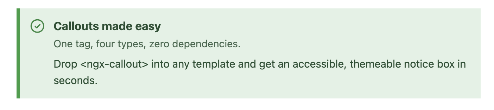

# ngx-callout

**Beautiful, accessible callouts for Angular.** Info, warning, error, success, tip and important notices in one tag, with zero dependencies.

[](https://www.npmjs.com/package/ngx-callout)
[](https://www.npmjs.com/package/ngx-callout)
[](https://www.npmjs.com/package/ngx-callout)
[](https://github.com/vishaalsharmaa/ngx-callout/blob/main/LICENSE)
[](https://vishaalsharmaa.github.io/ngx-callout/)

<p>
  
</p>

Think of `<ngx-callout>` as a coloured notice box: an icon, a title, a line of text, and anything else you put inside. Pick a type and it picks the colour.

```html
<ngx-callout type="success" heading="Callouts made easy" subheading="One tag, six types, zero dependencies.">
  Drop it into any template and get an accessible, themeable notice box in seconds.
</ngx-callout>
```

## Table of contents

- [Demo](#demo)
- [Features](#features)
- [Install](#install)
- [Usage](#usage)
- [Types](#types)
- [Inputs](#inputs)
- [Outputs and methods](#outputs-and-methods)
- [Examples](#examples)
  - [Width](#width)
  - [Collapsible content](#collapsible-content)
  - [Outline and rounded corners](#outline-and-rounded-corners)
  - [Custom icon and heading](#custom-icon-and-heading)
- [Accessibility](#accessibility)
- [Theming](#theming)
  - [Accent colour](#accent-colour)
  - [Individual shades](#individual-shades)
  - [CSS variables](#css-variables)
  - [Dark mode](#dark-mode)
- [Global configuration](#global-configuration)
- [Development](#development)
- [License](#license)

## Demo

**[Open the live demo and playground →](https://vishaalsharmaa.github.io/ngx-callout/)**

Change any input in a form and see the callout and its template code update as you go, in light and dark mode, on a Bootstrap 5 page.

## Features

- **Six strongly typed types**: `MessageState.Info`, `Warning`, `Error`, `Success`, `Tip` and `Important`
- **Icon, heading, sub-heading and any content** through `ng-content`
- **Accessible**: ARIA roles and labels, and a stable `id` on every element
- **Collapsible content** with an animated expand/collapse button
- **Full width or fit to content**
- **Outline and rounded corners**, each with one attribute
- **Themeable**: one accent colour or individual shades, CSS variables and dark mode
- **Responsive by default**: wraps long URLs and keeps images and code blocks inside the box
- **Standalone component**, signal inputs, `OnPush`, and no dependencies besides Angular

## Install

```bash
npm install ngx-callout
```

Requires Angular 21 or newer.

## Usage

Import `NgxCallout` into a standalone component:

```ts
import { Component } from '@angular/core';
import { MessageState, NgxCallout } from 'ngx-callout';

@Component({
  selector: 'app-page',
  imports: [NgxCallout],
  template: `
    <ngx-callout [type]="MessageState.Warning" heading="Heads up" subheading="This changes in v2">
      Any content goes here, including <a href="/docs">links</a>.
    </ngx-callout>
  `,
})
export class PageComponent {
  protected readonly MessageState = MessageState;
}
```

The `type` input also accepts the enum's string value, still type-checked: `type="warning"` compiles, `type="warn"` does not.

## Types

| Type | Enum | Use it for | Screen-reader role |
| --- | --- | --- | --- |
| 🔵 Info | `MessageState.Info` | Notes and neutral information (default) | `note` |
| 🟡 Warning | `MessageState.Warning` | Things to be careful about | `note` |
| 🔴 Error | `MessageState.Error` | Failures and blocking problems | `alert` |
| 🟢 Success | `MessageState.Success` | Confirmations and completed actions | `note` |
| 💡 Tip | `MessageState.Tip` | Helpful hints and best practices (teal, light-bulb icon) | `note` |
| 🟣 Important | `MessageState.Important` | Key information readers must not miss (purple) | `note` |

Each type has its own tinted background, coloured left bar and icon.

## Inputs

| Input | Type | Default | Description |
| --- | --- | --- | --- |
| `type` | `MessageState` or `'info' \| 'warning' \| 'error' \| 'success' \| 'tip' \| 'important'` | `MessageState.Info` | Sets the colours, icon and ARIA role. |
| `heading` | `string` | `''` | Bold heading. Hidden when empty. |
| `subheading` | `string` | `''` | Lighter text under the heading. Hidden when empty. |
| `showIcon` | `boolean` | `true` | Shows the type icon. |
| `outline` | `boolean` | `false` | Solid border on all four sides, in the same shade as the left bar. |
| `rounded` | `boolean` | `false` | Rounds all four corners (5px). |
| `fullWidth` | `boolean` | `true` | `true` fills the parent's width; `false` is only as wide as the content. |
| `accordionVisible` | `boolean` | `false` | Adds an arrow button that expands and collapses the content. |
| `defaultOpen` | `boolean` | `false` | Whether the collapsible content starts expanded. |
| `colors` | `CalloutColors` | none | Colour overrides for this callout. |
| `id` | `string` | `ngx-callout-{n}` | Id of the callout; inner element ids are derived from it. |
| `ariaLabel` | `string` | `'{Type}: {heading}'` | Accessible name of the callout. |
| `role` | `string` | `alert` for errors, else `note` | Overrides the ARIA role. |

Boolean inputs also work as bare attributes: `<ngx-callout outline rounded accordionVisible>`.

## Outputs and methods

| Output | Type | Description |
| --- | --- | --- |
| `openChange` | `boolean` | Emits `true` when the content expands and `false` when it collapses. |

| Method or signal | Description |
| --- | --- |
| `open()` | Expands the content. |
| `close()` | Collapses the content. |
| `toggle()` | Switches between expanded and collapsed. |
| `isOpen()` | Signal: `true` while the content is visible. |

These only have an effect when `accordionVisible` is on.

## Examples

### Width

By default a callout fills the full width of its parent. With `[fullWidth]="false"` it is only as wide as its heading, sub-heading and content, and still never wider than its parent.

```html
<ngx-callout type="success" heading="Saved" [fullWidth]="false" />
```

### Collapsible content

`accordionVisible` adds an arrow button in the top-right corner that expands and collapses the content inside the callout. The heading and sub-heading always stay visible.

```html
<!-- Starts collapsed -->
<ngx-callout type="info" heading="What's new in v2" accordionVisible>
  <ul>
    <li>Signal inputs</li>
    <li>Collapsible content</li>
  </ul>
</ngx-callout>

<!-- Starts expanded -->
<ngx-callout type="warning" heading="Breaking changes" accordionVisible defaultOpen>
  The <code>state</code> input is now called <code>type</code>.
</ngx-callout>
```

The arrow points down when collapsed and up when expanded, and the content slides open and closed. There is no animation for users who prefer reduced motion.

To react to changes or control it from code, use `(openChange)` and a template reference:

```html
<ngx-callout #notes heading="Release notes" accordionVisible (openChange)="onToggle($event)">…</ngx-callout>
<button (click)="notes.open()">Show notes</button>
```

Changing `defaultOpen` later resets the callout to that state.

### Outline and rounded corners

```html
<ngx-callout type="info" heading="Outlined and rounded" outline rounded />
```

`outline` adds a 1px border on the top, right and bottom, in the same shade as the left bar. `rounded` rounds all four corners by 5px. Change the sizes with `--ngx-callout-outline-width` and `--ngx-callout-radius`.

### Custom icon and heading

The default slot takes any content. Two named slots replace the built-in icon or heading:

```html
<ngx-callout [type]="MessageState.Success">
  <svg ngxCalloutIcon viewBox="0 0 24 24">…</svg>
  <span ngxCalloutHeading>Version <code>2.0</code> is out</span>
  <p>Release notes…</p>
</ngx-callout>
```

Import `NgxCalloutIcon` and `NgxCalloutHeading` alongside `NgxCallout` to use them.

## Accessibility

With `id="tip"`, the callout renders:

| Element | id | Accessibility |
| --- | --- | --- |
| Callout | `tip` | `role="note"` (or `alert`), `aria-label="Warning: Heads up"` |
| Icon | `tip-icon` | `role="img"`, `aria-label="Warning"` |
| Body | `tip-body` | |
| Heading | `tip-heading` | |
| Sub-heading | `tip-subheading` | |
| Content | `tip-content` | Hidden from screen readers and keyboard focus while collapsed |
| Toggle button | `tip-toggle` | `aria-expanded`, `aria-controls="tip-content"`, `aria-label="Show details"` / `"Hide details"` |

- Plain text elements don't get an `aria-label`. ARIA doesn't allow names on generic elements, and screen readers already read their text.
- Error callouts use `role="alert"`, so screen readers announce them as soon as they appear. Pass `role="note"` to opt out.
- All screen-reader text can be translated with [global configuration](#global-configuration).

## Theming

### Accent colour

Every shade (background, border, text and icon) is derived from one accent colour:

```html
<ngx-callout [type]="MessageState.Info" [colors]="{ accent: '#6d28d9' }" heading="Brand colour" />
```

### Individual shades

```ts
const colors: CalloutColors = {
  accent: '#ea580c',
  background: '#fff1e6',
  border: '#9a3412',
  text: '#431407',
  heading: '#431407',
  icon: '#c2410c',
};
```

A hand-set `background` stays the same in light and dark themes. When you set it, set `text` and `heading` as well, so they stay readable on a dark surface.

### CSS variables

Theme from CSS, without TypeScript:

```css
:root {
  --ngx-callout-info-accent: #6d28d9;
  --ngx-callout-warning-accent: #f59e0b;
  --ngx-callout-error-accent: #be123c;
  --ngx-callout-success-accent: #15803d;
  --ngx-callout-tip-accent: #0d9488;
  --ngx-callout-important-accent: #7c3aed;

  --ngx-callout-radius: 8px; /* used when rounded is on */
  --ngx-callout-padding: 16px 20px;
  --ngx-callout-border-width: 4px;
}
```

| Variable | Default |
| --- | --- |
| `--ngx-callout-{type}-accent` | Built-in colour per type |
| `--ngx-callout-accent` | Per-type accent |
| `--ngx-callout-bg` | 14% accent on the surface |
| `--ngx-callout-border` | Accent |
| `--ngx-callout-text` | 35% accent on the ink colour |
| `--ngx-callout-heading` | Text colour |
| `--ngx-callout-icon` | 80% accent on the ink colour |
| `--ngx-callout-surface` | `#ffffff` |
| `--ngx-callout-ink` | `#1b2230` |
| `--ngx-callout-radius` | `5px` (when `rounded`) |
| `--ngx-callout-outline-width` | `1px` (when `outline`) |
| `--ngx-callout-padding` | `14px 18px 14px 14px` |
| `--ngx-callout-border-width` | `5px` |
| `--ngx-callout-gap` | `12px` |
| `--ngx-callout-font-size` | `0.95rem` |

Order of precedence, highest first: the `colors` input, `provideCallout({ colors })`, CSS variables, built-in defaults.

### Dark mode

Set your dark theme's background and text colours, and every shade follows:

```css
.dark-theme {
  --ngx-callout-surface: #11151c;
  --ngx-callout-ink: #e4e8f0;
}
```

With Bootstrap 5.3, map them to Bootstrap's own variables once and callouts follow `data-bs-theme` automatically:

```css
:root {
  --ngx-callout-surface: var(--bs-body-bg);
  --ngx-callout-ink: var(--bs-body-color);
}
```

## Global configuration

Set defaults for every callout in `app.config.ts`. Everything is optional:

```ts
import { ApplicationConfig } from '@angular/core';
import { MessageState, provideCallout } from 'ngx-callout';

export const appConfig: ApplicationConfig = {
  providers: [
    provideCallout({
      showIcon: true,
      outline: false,
      rounded: true,
      fullWidth: true,
      accordionVisible: false,
      defaultOpen: false,
      colors: {
        [MessageState.Info]: { accent: '#6d28d9' },
        [MessageState.Error]: { accent: '#be123c' },
      },
      // Translate screen-reader text
      labels: { [MessageState.Info]: 'Hinweis' },
      accordionLabels: { expand: 'Mehr anzeigen', collapse: 'Weniger anzeigen' },
    }),
  ],
};
```

Inputs on a single callout always win over these defaults.

## Development

```bash
npm install
npm run build:lib    # builds dist/ngx-callout
npm run test:lib     # unit tests
npm start            # demo app at http://localhost:4200
```

## License

[MIT](https://github.com/vishaalsharmaa/ngx-callout/blob/main/LICENSE) © 2026 Vishal Sharma
